## Прошлое занятие ##

* формальные модели как абстрактные модели
* что такое синтаксис?
* обзор материала
* синтаксическая структура и порядок слов
* части речи
    - дистрибутивные критерии
    - формальные критерии
* структура составляющих: диагностические тесты

## Сегодня ##

  * внутренняя структура групп
      * вершина, комплемент, адъюнкт, спецификатор
  * предложение как составляющая

# Структура групп #

## Первое приближение ##

Мы уже видели, что группы демонстрируют иерархическую организацию: в них есть главные и зависимые элементы.

## Общая теория групп: лексические категории ##

Лексические категории N, V и A  образуют NP, VP и AP.

::: {style="text-align: center;"}
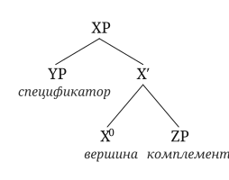{ width=40% .lightbox }
:::

Вершина задаёт поведение всей группы и является её обязательным элементом.

## Отсутствующие узлы ##

Вершина в группе обязательна, её зависимые — нет.

::: {layout-ncol=2}
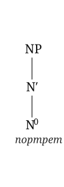{.lightbox}

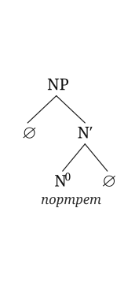{.lightbox}
:::

Репрезентации выше являются эквивалентными.

## Сокращение нотации ##

Иногда можно игнорировать внутреннюю структуру составляющей. Это обозначается треугольником:

::: {style="text-align: center;"}
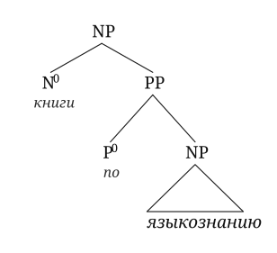{ width=40% }
:::

При необходимости содержимое треугольника можно полностью восстановить.

# X′-структура: пошаговая инструкция #

## Представление словосочетаний ##

словосочетания → **иерархия**

+ как показать это наглядно?\
= как **представить графически**?

## Принципы построения словосочетаний ##

* **вершина** = одно слово
* **комплементы** и **адъюнкты** = слово**сочетания** (с собственными вершинами и зависимыми)
* предложение также является группой/составляющей
* в предложении каждое слово является вершиной группы

## Пошаговая инструкция ##

*Тот человек купил интересные книги*

* Наша цель — разметить словосочетания в терминах иерархической структуры:
    * [ [ тот человек ] [ купил [ интересные книги ] ] ]

::: {style="text-align: center;"}
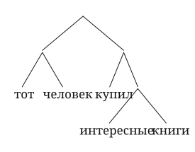{ width=35% }
:::

## Шаг 1: Определяем вершины ##

= определяем части речи/категории

* применяем формальные и дистрибутивные критерии
* подписываем категориальные обозначения

тот~D~ человек~N~  купил~V~  интересные~A~  книги~N~

**(в предложении каждое слово является вершиной группы)**

## Шаг 2: Объединяем элементы в словосочетания ##

*Тот человек купил интересные книги*

**Определяем связи**

тот~D~ человек~N~  купил~V~  интересные~A~  книги~N~

* тот~D~ человек~N~ → [~NP~ [~D~ тот ] [~NP~ человек ] ]
* интересные~A~  книги~N~ → [~NP~ [~AP~ интересные ] [~NP~ [~N~ книги ] ] ]

Применяем тесты на составляющие.

## Шаг 3: Выявляем аргументную структуру  ##

Аргументная структура — [предикат]{.c2} и его [аргументы]{.c3}.

* [Тот человек]{.c3} [купил]{.c2} [интересные книги]{.c3}

Что делать с глаголом *купил*?

купил~V~ + [~NP~ [~AP~ интересные ] [~NP~ [~N~ книги ]]]

= [~VP~ купил~V~ [~NP~ [~AP~ интересные ] [~NP~ [~N~ книги ]]] ]

## Шаг 4: Собираем элементы в предложение ##

Объединяем [субъект]{.c1} и [предикат]{.c2}:

[~S~ [[~NP~ [~D~ тот ] [~NP~ человек ]]]{.c1} [[~VP~ [~V~ купил] [~NP~ [~AP~ интересные ] [~N~ книги]]]]{.c2} ]

::: {.fragment}

И получаем дерево:

::: {style="text-align: center;"}
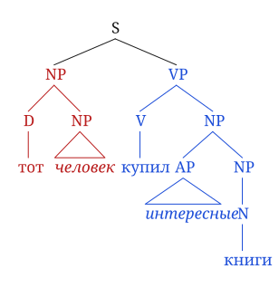{.lightbox}
:::
:::

## При чём тут языковая способность? ##

Вспомним, что знание языка

* скрыто и недоступно для прямого изучения
* сложно
* возникает без специального обучения
* возникает на основе «бедного» стимула

## От языкового поведения к абстрактной модели ##

* люди в процессе усвоения языка интернализуют **грамматику**
    * т.е. набор правил
* грамматики — это гипотезы, а потом и теории, знания языка
    * научный метод: их необходимо эмпирически проверять
    * также их необходимо **сравнивать**
* структура составляющих — абстрактный способ сравнивать правила и состоящие из них грамматики

## Составляющие и синтаксические деревья ##

Синтаксические деревья — всего лишь способ **записи** наблюдений об иерархической структуре

* маловероятно, что репрезентации высказываний на естественном языке имеют вид синтаксических деревьев в психо-/нейролингвистической реальности
* ср. формулы в органической химии:\
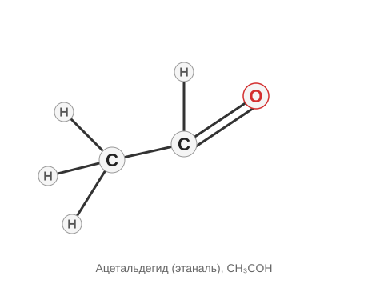

## Ещё о схеме X′ 

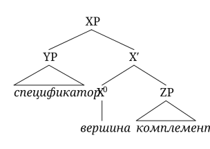{.lightbox}

## Комплементы, спецификаторы и адъюнкты ##

Чтобы понимать, чем разные виды зависимых отличаются друг от друга, нужно чётко разделять разные уровни проекции:

* минимальные проекции (X^0^) — это вершины без зависимых
* промежуточные проекции (X′) — это вершина и комплемент
* максимальные проекции (XP) — это промежуточная проекция и спецификатор

## Адъюнкция не меняет уровень проекции

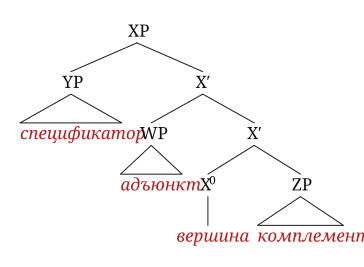{.lightbox}
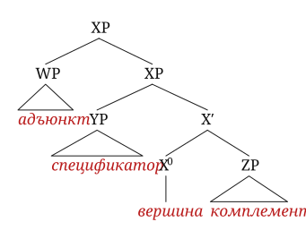{.lightbox}

----------------

Вершины, комплементы и спецификаторы отличаются от адъюнктов.

  * вершина у составляющей всегда одна
  * у вершины может быть максимум один комлемент
      * *\*читать книгу газету*
  * у составляющей может быть максимум один спецификатор
      * *\*the my apple*
  * комплементы и спецификаторы бывают обязательными
      * *\*Маша определяет*, *\*eat apple*
  
Адъюнкты

  * не являются обязательными
      * _Маша ела кашу._
  * количество адъюнктов не ограничено
      * _Маша ела вкусную манную кашу на крыше в пятницу в полном одиночестве._
      
# Предложение как группа #

## NP + VP = S? ##

Подлежащие легко анализируются в терминах теории Х-штрих, и сказуемые тоже.

Но как быть, когда они встречаются?

Традиционный подход заключается в том, чтобы считать, что синтаксическая связь в предложении имеет совершенно иную природу, нежели синтаксические связи в словосочетании. 

--------------

При внимательном рассмотрении можно заметить, что предложение так же проявляет свойства группы.

* что является вершиной этой группы?
    * глагол?
    * подлежащее?
	
→ иной, **функциональный**, элемент

(кроме того, если немного выглянуть за пределы русского языка, мы увидим, что и самые обычные словосочетания проявляют типы синтаксической связи, характерные для предложения)

## Двунаправленная синтаксическая связь 

### Предложение

- падеж подлежащего определяется глаголом
- форма глагола определяется свойствами подлежащего

::: {.fragment}

### Словосочетание

::: {.gl}
mon’ kud-əz’ə\
я.GEN дом-POSS.1SG\
‘мой дом’
:::

:::

## Предложение как составляющая ##

Если предположить, что предложение -- это составляющая, то это должно быть видно при применении стандартных тестов.

### Замена ###

* *Я знаю,* [ *что он пришёл* ].
    * Я знаю [это].

### Перемещение ###

* *Я знаю,* [ *что он пришёл* ].
    *  [ *Что он пришёл* ], *я знаю*.

→ *что он пришёл* — одновременно и предложение, и составляющая.

::: {style="text-align: center;"}
::: {.fragment}

Что является вершиной этой составляющей?

:::
:::

## Предложение и X′-схема ##

Рассмотрим предложение *Пекарь будет печь хлеб*.

[~N~ пекарь ] [~V~ печь ] [~N~ хлеб ] [~??~ будет ]

Предположим, что *будет* выражает *время* и реализует функциональную категорию T (от англ. *tense* ‘время’)

::: {style="text-align: center;"}
::: {.fragment}
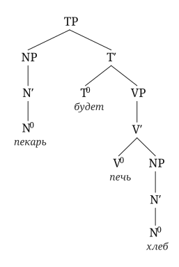{.lightbox}

:::
:::

----------------------------

Так же анализируются финитные предложения без вспомогательного глагола:

::: {style="text-align: center;"}
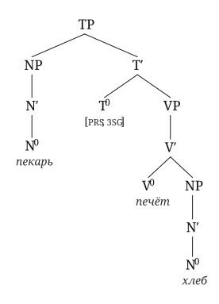{.lightbox}
:::

## Ещё о *будет печь* и статусе вершины T ##

(Нефинитный) глагол + дополнение образуют составляющую, не включающую в себя вспомогательный глагол:

  * *Что будет делать пекарь?*
  * *Печь хлеб.*

Это неожиданно, если *будет* образует составляющую с *печь*, не включающую в себя дополнение.

## Зачем X′? Комплементы и адъюнкты ##

### *do so* substitution ###

Вспомним о существовании в английском языке специальной глагольной проформы *do so*.

  * *The children will [eat the pizza]{.fragment .highlight-red}.*
  * *Their parents will [do so]{.fragment .highlight-red} too.*
      * проформа *do so* заменяет цепочку V + NP
      * и не заменяет просто глагол:
          * \**Their parents will [do so]{.fragment .highlight-red} the pizza.*

V + NP — это и есть V′.

----------------------

### *one* substitution ###

Английская проформа *one* заменяет N′:

  * *this **book on the floor** and that **one***
  * *this **book** on the floor and that **one** on the table*

## *a student of physics from Cambridge* ##

Несколько фактов

### Важно взаимное расположение зависимых ###

  * *a student of physics from Cambridge*
  * *\*a student from Cambridge of physics*

### Важна заменяемость проформой *one* ###

  * *a **student of physics** from Cambridge and another **one** from Oxford*
  * *\*a student of physics from Cambridge and another one of chemistry from Oxford*

